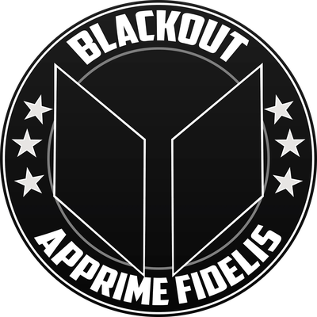
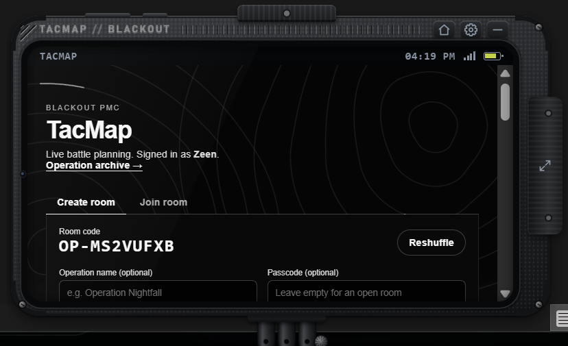

# 📟 TacMap Overlay

**BLACKOUT PMC's TacMap, on a rugged field phone that sits on top of your game.**

Plan, ping and follow the op without ever alt-tabbing.

 

---

## ⚡ Features

- **Always on top.** The phone stays above Roblox, even in fullscreen.
- **Small or big.** Keep it small in a corner while you play, then open it up to plan.
- **Live TacMap.** Join rooms, see pings, cursors and plans in real time, the same as on the website.
- **Works while small.** Pan, zoom, measure, ping and draw straight from the small phone.
- **Make your own rooms or join private ones.** Passcode rooms work too.
- **Import plans.** Load operation files right on the phone.
- **Resize it.** Drag the grip in the top-left corner to scale the phone.
- **4 case colours.** Black, Tan, Ranger Green and Varicam Black.
- **Custom hotkeys.** Set your own key combinations in Settings.
- **Remembers you.** Your room, position, size and settings are kept between sessions.

---

## 📥 Install

1. Go to **[Releases](https://github.com/Zeenorox/TacMap-Overlay-Releases/releases/latest)**.
2. Download **`TacMap Overlay Setup x.x.x.exe`**.
3. Run it and follow the installer.

> [!NOTE]
> Windows may say **"Windows protected your PC"**. That's because the app isn't code-signed (signing certificates are expensive), not because anything is wrong.
> Click **More info → Run anyway**.

**Requirements:** Windows 10 or 11 (64-bit), and a BLACKOUT Discord account.

---

## 🎮 How to use

1. Open **TacMap Overlay**. The phone starts up in the bottom-right corner.
2. **Sign in with Discord** on the phone (first time only).
3. Create a room, join one with its code, or plan on your own.
4. Play. The phone stays on top of your game.

| Action | How |
|---|---|
| Move the phone | Hold and drag the **top edge** of the case |
| Make it bigger / smaller | Click the **side bracket**, or press `Ctrl + Shift + F2` |
| Show / hide the phone | `Ctrl + Shift + F1` |
| Resize the phone | Drag the **grip in the top-left corner** |
| Back to the room list | 🏠 button on the case |
| Settings, case colour, hotkeys | ⚙️ button on the case |

> [!TIP]
> Hotkeys can be changed in ⚙️ **Settings → Hotkeys**: click one, then press your new keys.

---

## ❓ FAQ

**Does this touch or modify Roblox?**
No. It's a separate window that stays on top of your screen. It doesn't read, inject into or change the game in any way.

**What does it sign in with?**
Your Discord account, through the BLACKOUT website, the same as TacMap on the web. It only shows TacMap pages; the rest of the website opens in your normal browser.

**How do I update?**
Download the newest installer from **Releases** and run it. Your settings are kept.

**How do I uninstall?**
Windows Settings → **Apps** → **TacMap Overlay** → Uninstall.

**Something's broken!**
Report it in the BLACKOUT Discord server with a screenshot and what you were doing.

---

**BLACKOUT PMC** · *Apprime Fidelis*

Made with ☕ by **Zeenorox**

